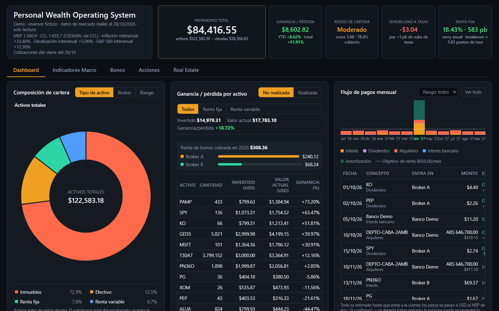
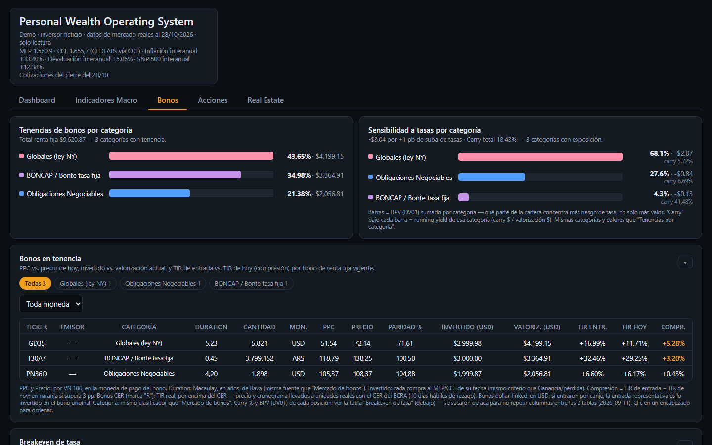
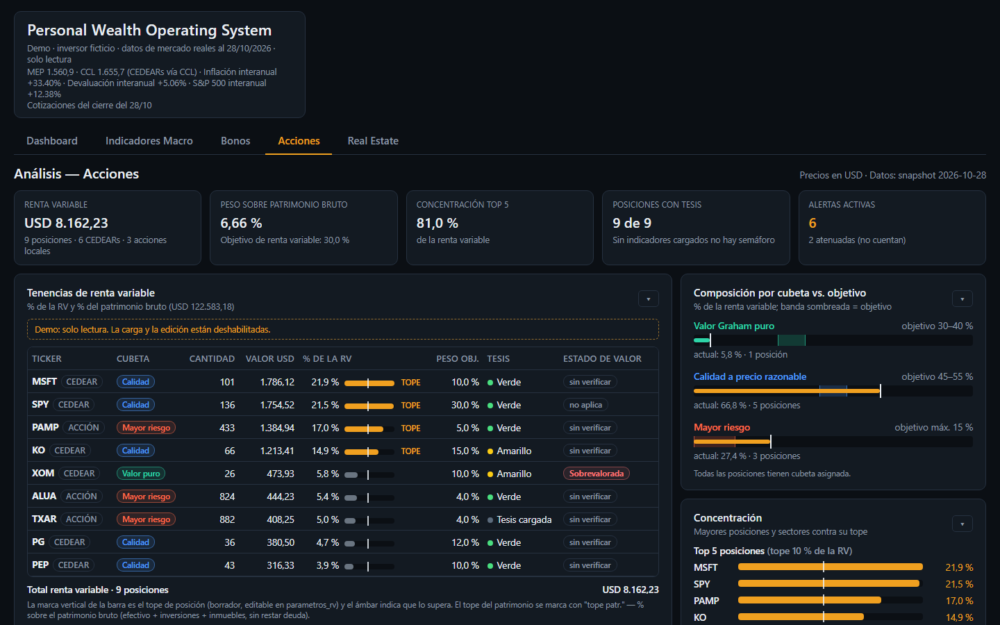
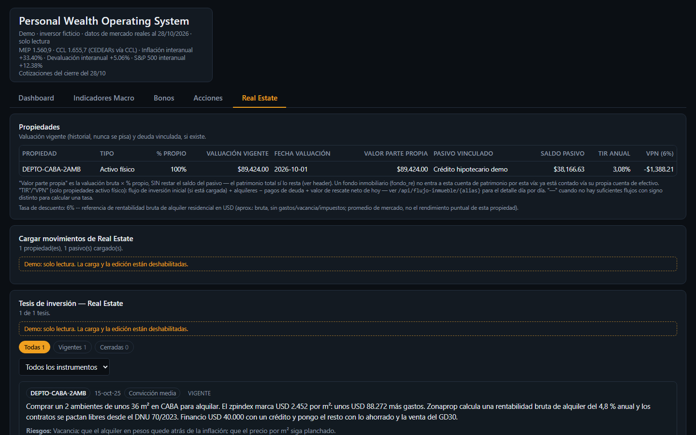
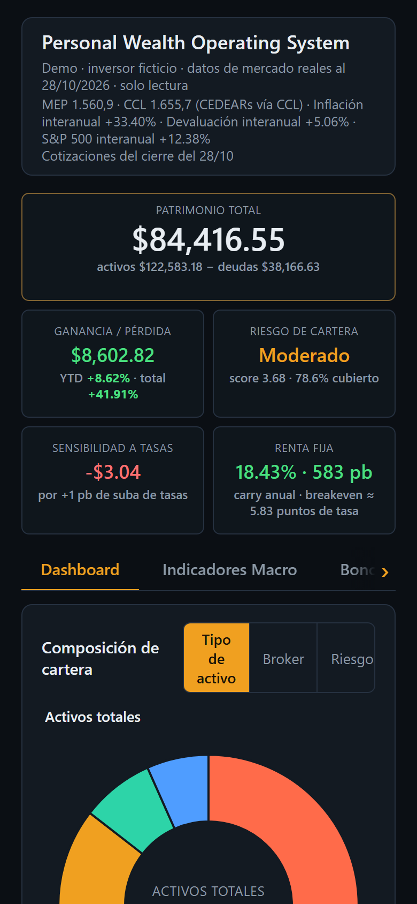
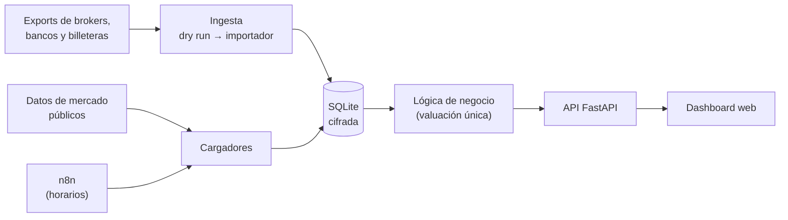

# PWOS — Personal Wealth Operating System

[English](README.md) · **Español**

> Un sistema operativo patrimonial personal: reúne en un solo lugar inversiones, cuentas, inmuebles y deudas, y responde con datos las preguntas que una planilla ya no puede responder.

     



<sub>Captura de la [demo](#cómo-correr-la-demo): inversor ficticio, datos de mercado reales al 28/10/2026.</sub>

---

## El problema

Quien invierte en Argentina suele tener el patrimonio repartido en muchos lugares: varios brokers, bancos, billeteras virtuales, plazos fijos, bonos en pesos y en dólares, CEDEARs, acciones locales, inmuebles y alguna deuda. Cada institución muestra su propio pedacito, en su propia moneda y con su propia lógica.

Una planilla manual funciona al principio, pero con los años mezcla transferencias con gastos, no separa lo que creció por ahorro de lo que creció por rendimiento, y no puede contestar preguntas como *"¿cuánto me van a pagar mis bonos el mes que viene?"* o *"¿estoy demasiado expuesto al riesgo argentino?"*.

## Qué hace PWOS

PWOS lleva el registro de **cada movimiento** de cada institución y, a partir de eso, calcula todo lo demás:

| Pregunta | Cómo la responde |
|---|---|
| **¿Cuánto tengo?** | Patrimonio neto en dólar MEP, por tipo de activo, por institución y por moneda |
| **¿Gané o perdí?** | Ganancia realizada y no realizada, y rendimiento mensual separando **aportes** de **rendimiento** |
| **¿Qué me genera ingresos?** | Calendario de cupones, amortizaciones, dividendos y alquileres: estimado contra cobrado |
| **¿Estoy concentrado?** | Composición renta fija / renta variable, por sector, por emisor y por institución |
| **¿Cómo están mis bonos?** | TIR, duration, sensibilidad a tasas, carry y breakeven de cada bono en cartera, y comparación contra el mercado |
| **¿Qué pasa en la macro?** | Más de 60 indicadores argentinos y globales con historial, umbrales y alertas |
| **¿Se cumple mi tesis?** | Bitácora de tesis de inversión con condiciones medibles que se chequean solas |
| **¿Cómo rinde un inmueble?** | Valuación, alquileres, gastos, deuda, TIR y VPN de cada propiedad |

El análisis **diagnostica, no recomienda**: el sistema muestra e interpreta los datos, la decisión es siempre humana.

## Capturas

Todas son de la demo (inversor ficticio, datos de mercado reales al 28/10/2026).

| Bonos | Acciones |
|---|---|
|  |  |
| **Real Estate** | **Celular** |
|  |  |

## Cómo está construido



- **Base SQLite cifrada en reposo**, modelada por movimientos (nunca se cargan saldos a mano: se calculan).
- **Ingesta en dos pasos**: un *dry run* que no escribe nada y muestra qué entraría; después el importador carga solo lo nuevo, sin duplicar.
- **Valuación centralizada**: un único módulo convierte todo a la unidad de cuenta (dólar MEP).
- **API FastAPI + frontend HTML/CSS/JS sin framework**, en Docker, accesible solo por red privada.
- **n8n** trae precios, tipos de cambio e indicadores según un horario, rellena huecos si la PC estuvo apagada y avisa por mail si algo falla.

Detalle completo en la [arquitectura general](docs/arquitectura/arquitectura-general.md).

## Stack

| Capa            | Tecnología                                                    |
| --------------- | ------------------------------------------------------------- |
| Lenguaje        | Python                                                        |
| Base de datos   | SQLite (cifrada con VeraCrypt)                                |
| API             | FastAPI + Uvicorn                                             |
| Frontend        | HTML, CSS y JavaScript plano                                  |
| Datos           | pandas, yfinance, fuentes públicas (BCRA, Rava, BYMA y otras) |
| Orquestación    | n8n                                                           |
| Infraestructura | Docker, Tailscale, Windows Credential Manager                 |
| Pruebas         | pytest                                                        |

## Documentación

| Documento | Responde |
|---|---|
| [Arquitectura general](docs/arquitectura/arquitectura-general.md) | ¿Cómo se conectan las piezas? |
| [Modelo de dominio](docs/arquitectura/modelo-de-dominio.md) | ¿Qué significa cada concepto (contenedor, cuenta, movimiento…)? |
| [Schema de la base](docs/arquitectura/schema-base-datos.md) | ¿Qué tablas hay y cómo se relacionan? (generado por script) |
| [Decisiones de arquitectura](docs/decisiones/README.md) | ¿Por qué está hecho así? (ADRs) |
| [Hoja de ruta](docs/roadmap.md) | ¿Qué está hecho y qué viene? |
| [Glosario](docs/glosario.md) | ¿Qué quiere decir este término? |

## Estado del proyecto

PWOS está **en uso diario** para un patrimonio real. Por eso este repositorio publica el código y la documentación, pero **no los datos**: la base, los exports y las credenciales nunca salen del entorno privado.

Para verlo funcionando hay una **demo**: un inversor ficticio con datos de mercado reales de cada fecha (ver [Cómo correr la demo](#cómo-correr-la-demo)).

## Cómo correr la demo

Hace falta [Docker](https://docs.docker.com/get-docker/) con Docker Compose. Desde la raíz del repositorio:

```
docker compose up --build
```

y abrir http://localhost:8001.

Ese comando arma la imagen, genera la base de la demo bajando los datos de mercado de las fuentes públicas y la sirve en modo demo, de solo lectura.

- **Cuánto tarda:** la primera vez, unos 27 minutos (medido desde cero el 31/10/2026). Unos 10 minutos son la imagen: bajar las dependencias de Python, que depende de la conexión. Los otros 17 son bajar los datos de mercado y generar la base. Si Docker todavía no tiene la imagen base de Python, suma esa descarga (~50 MB). Después, la base y la caché quedan en el volumen `demo-datos` y la demo arranca en segundos.
- **Regenerarla:** `docker compose down -v` y de nuevo `docker compose up`.
- **Fecha de corte:** `DEMO_CORTE=AAAA-MM-DD` fija la fecha (por defecto, el último día hábil cerrado).
- **Series de EE.UU.:** con `FRED_API_KEY` (clave gratuita de FRED) se cargan también las series de FRED.

Qué es real y qué es inventado, cómo generarla sin Docker y sus limitaciones: [docs/demo.md](docs/demo.md).

Los tests públicos corren sin red y sin datos privados: `cd database` y `python -m pytest` con `PWOS_MODO=demo` y `PWOS_CONFIG=config/demo.json`. GitHub Actions los corre en cada push.

## Fuentes de datos

PWOS no tiene datos propios de mercado: los baja de fuentes públicas. **Los datos son de sus dueños** y acá se usan con fines personales y educativos; cada fuente tiene sus propios términos de uso.

| Fuente | Qué se usa |
|---|---|
| [ArgentinaDatos](https://argentinadatos.com) | Dólar MEP y CCL histórico, riesgo país, inflación |
| [BCRA, API de estadísticas](https://www.bcra.gob.ar/) | Reservas, compras de divisas, CER, dólar A3500, tasas de plazo fijo, REM, ITCRM, informe de bancos |
| [DolarApi](https://dolarapi.com) | Dólar MEP y CCL del día |
| [Rava Bursátil](https://www.rava.com) | Precios históricos de bonos, ONs y LECAPs, cronogramas de pago, universo de renta fija |
| [data912](https://data912.com) | Cotizaciones en vivo de BYMA y paneles de CEDEARs |
| [Yahoo Finance](https://finance.yahoo.com) (vía `yfinance`) | Precios de CEDEARs, acciones e índices, dividendos, fundamentales, betas |
| [BYMA](https://www.byma.com.ar) y [Banco Comafi](https://www.comafi.com.ar) | Ratios de conversión de los CEDEARs |
| [FRED](https://fred.stlouisfed.org) (Fed de St. Louis) | Series macro de EE.UU. (tasas, empleo, inflación, crédito, liquidez) |
| [INDEC](https://www.indec.gob.ar) | EMAE, industria, construcción |
| Ministerio de Economía, OEDE/SIPA y DNRPA ([datos.gob.ar](https://datos.gob.ar)) | Deuda y resultado fiscal, empleo registrado, patentamientos |
| [Zonaprop](https://www.zonaprop.com.ar) (zpindex) | Precio de venta por m² y alquiler de referencia en CABA, Córdoba y Rosario |
| [Robert Shiller](http://www.econ.yale.edu/~shiller/data.htm) | CAPE del S&P 500 |
| FactSet Earnings Insight, NY Fed / CME | P/E forward del S&P 500, tasa de la Fed y probabilidades de la próxima reunión |

## Sobre el proyecto

Proyecto personal construido mientras aprendo desarrollo de software, datos e infraestructura, con asistencia de IA (Claude) como mentor y par de programación. Cada decisión técnica está documentada en los [ADRs](docs/decisiones/README.md).

Autor: [@bporcel-code](https://github.com/bporcel-code)

## Licencia

Todos los derechos reservados. El código se publica para consulta: se puede clonar el repositorio y correr la demo localmente para evaluarlo, pero no usarlo, copiarlo, modificarlo ni distribuirlo sin autorización escrita. Detalle en [LICENSE](LICENSE).

---

© 2026 Bruno Porcel de Peralta · [Licencia](LICENSE)
