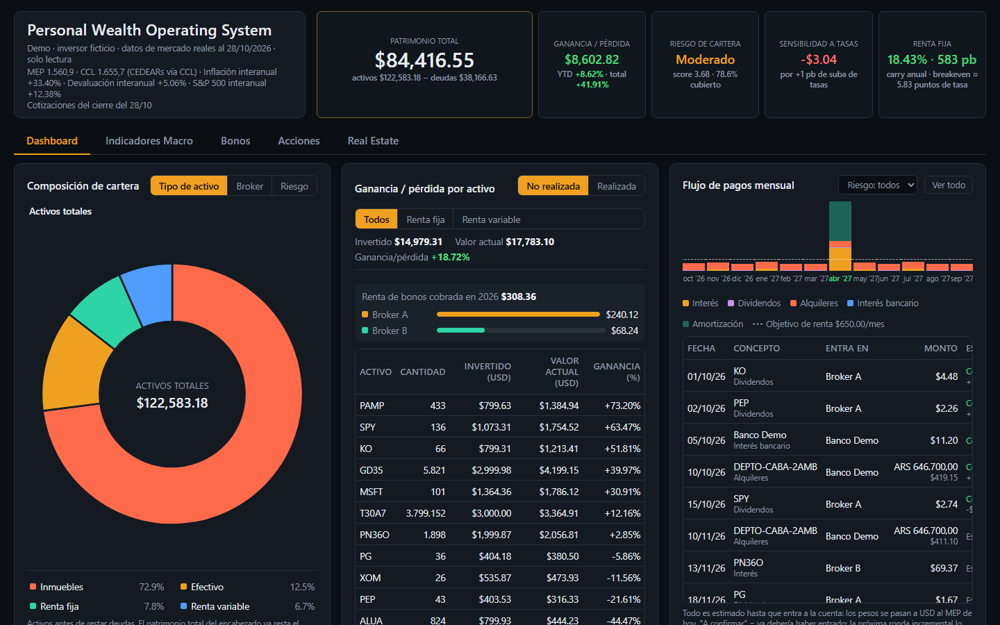
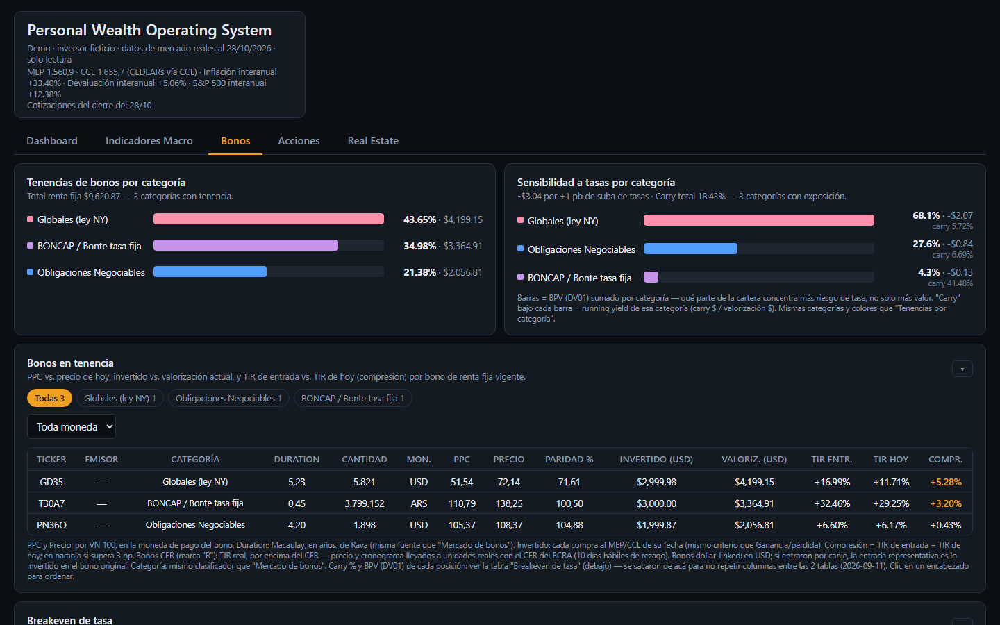
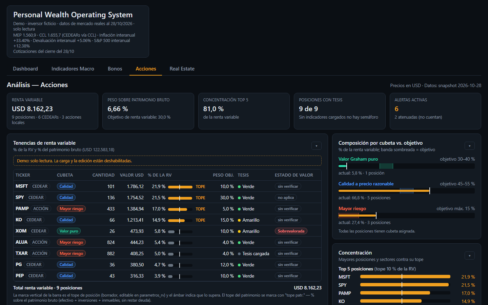
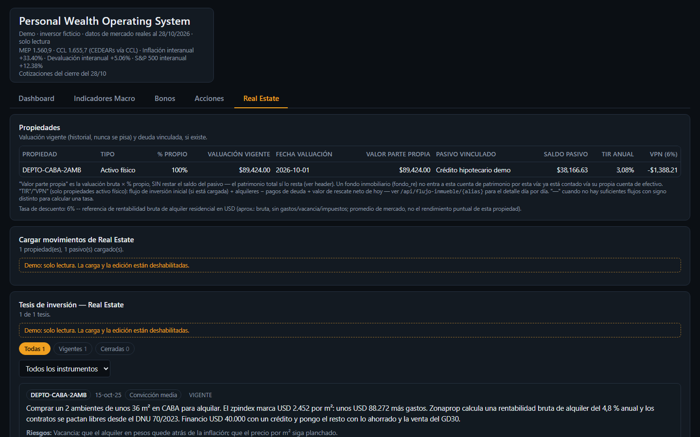
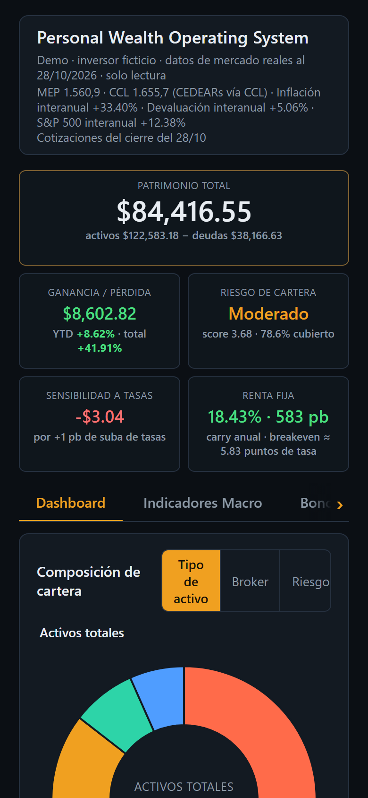
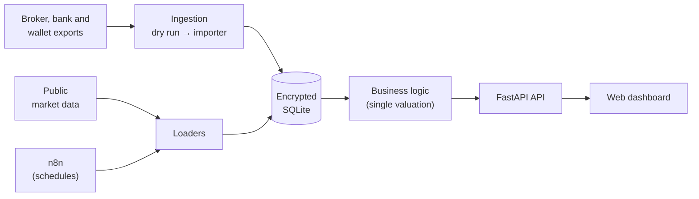

# PWOS — Personal Wealth Operating System

**English** · [Español](README.es.md)

> A personal wealth operating system: it brings investments, bank accounts, real estate and debt into one place, and answers with data the questions a spreadsheet no longer can.

     



<sub>Screenshot of the [demo](#running-the-demo): a fictional investor, with real market data as of 2026-10-28.</sub>

> **Why is everything else in Spanish?** The domain is Argentine — MEP dollar, CEDEARs, the Central Bank (BCRA), peso-denominated bonds — so the UI, the code and the documentation are in Spanish. This README is the English entry point.

---

## The problem

An investor in Argentina usually has their wealth spread across many places: several brokers, banks, digital wallets, fixed-term deposits, bonds in pesos and in dollars, CEDEARs (local certificates for foreign stocks), local shares, real estate and some debt. Each institution shows its own slice, in its own currency and with its own logic.

A spreadsheet works at first, but over the years it mixes transfers with expenses, can't tell how much of the growth came from saving and how much from returns, and can't answer questions like *"how much will my bonds pay me next month?"* or *"am I too exposed to Argentine risk?"*.

## What PWOS does

PWOS records **every transaction** from every institution and computes everything else from there:

| Question | How it answers |
|---|---|
| **How much do I have?** | Net worth in MEP dollars, by asset type, institution and currency |
| **Did I make or lose money?** | Realized and unrealized gains, and monthly returns that separate **contributions** from **performance** |
| **What generates income?** | A calendar of coupons, amortizations, dividends and rents: expected vs. collected |
| **Am I concentrated?** | Fixed income vs. equity, by sector, issuer and institution |
| **How are my bonds doing?** | YTM, duration, rate sensitivity, carry and breakeven for each bond held, compared against the market |
| **What is the macro doing?** | Over 60 Argentine and global indicators with history, thresholds and alerts |
| **Does my thesis still hold?** | An investment-thesis log with measurable conditions that check themselves |
| **How does a property perform?** | Valuation, rents, expenses, debt, IRR and NPV for each property |

The analysis **diagnoses, it doesn't recommend**: the system shows and interprets the data; the decision is always human.

## Screenshots

All of them come from the demo (a fictional investor, real market data as of 2026-10-28).

| Bonds | Equities |
|---|---|
|  |  |
| **Real estate** | **Mobile** |
|  |  |

## How it's built



- **SQLite database encrypted at rest**, modeled on transactions (balances are never entered by hand: they are computed).
- **Two-step ingestion**: a *dry run* that writes nothing and shows what would go in; then the importer loads only what's new, without duplicates.
- **Centralized valuation**: a single module converts everything to the unit of account (the MEP dollar).
- **FastAPI API + framework-free HTML/CSS/JS frontend**, in Docker, reachable only over a private network.
- **n8n** fetches prices, exchange rates and indicators on a schedule, backfills gaps if the PC was off, and emails if something fails.

Full details in the [architecture overview](docs/arquitectura/arquitectura-general.md) (in Spanish).

## Stack

| Layer          | Technology                                                    |
| -------------- | ------------------------------------------------------------- |
| Language       | Python                                                        |
| Database       | SQLite (encrypted with VeraCrypt)                             |
| API            | FastAPI + Uvicorn                                             |
| Frontend       | Plain HTML, CSS and JavaScript                                |
| Data           | pandas, yfinance, public sources (BCRA, Rava, BYMA and others) |
| Orchestration  | n8n                                                           |
| Infrastructure | Docker, Tailscale, Windows Credential Manager                 |
| Testing        | pytest                                                        |

## Documentation (in Spanish)

| Document | Answers |
|---|---|
| [Architecture overview](docs/arquitectura/arquitectura-general.md) | How do the pieces connect? |
| [Domain model](docs/arquitectura/modelo-de-dominio.md) | What does each concept mean (container, account, transaction…)? |
| [Database schema](docs/arquitectura/schema-base-datos.md) | Which tables exist and how do they relate? (generated by a script) |
| [Architecture decisions](docs/decisiones/README.md) | Why is it built this way? (ADRs) |
| [Roadmap](docs/roadmap.md) | What's done and what's next? |
| [Glossary](docs/glosario.md) | What does this term mean? |

## Project status

PWOS is **in daily use** for a real portfolio. That's why this repository publishes the code and the documentation, but **not the data**: the database, the exports and the credentials never leave the private environment.

To see it running there is a **demo**: a fictional investor with the real market data of each date (see [Running the demo](#running-the-demo)).

## Running the demo

You need [Docker](https://docs.docker.com/get-docker/) with Docker Compose. From the repository root:

```
docker compose up --build
```

then open http://localhost:8001.

That command builds the image, generates the demo database by downloading market data from public sources, and serves it in read-only demo mode.

- **How long it takes:** about 27 minutes the first time (measured from scratch on 2026-10-31). Around 10 minutes go to the image — downloading the Python dependencies, which depends on your connection — and the other 17 to downloading market data and generating the database. If Docker doesn't have the Python base image yet, add that download (~50 MB). After that, the database and the cache live in the `demo-datos` volume and the demo starts in seconds.
- **Regenerate it:** `docker compose down -v`, then `docker compose up` again.
- **Cutoff date:** `DEMO_CORTE=YYYY-MM-DD` sets the date (by default, the last closed business day).
- **US series:** with `FRED_API_KEY` (a free FRED key) the FRED series are loaded too.

What's real and what's made up, how to generate it without Docker, and its limitations: [docs/demo.md](docs/demo.md) (in Spanish).

The public tests run without network access and without private data: `cd database` and `python -m pytest` with `PWOS_MODO=demo` and `PWOS_CONFIG=config/demo.json`. GitHub Actions runs them on every push.

## Data sources

PWOS has no market data of its own: it downloads it from public sources. **The data belongs to its owners** and is used here for personal and educational purposes; each source has its own terms of use.

| Source | What is used |
|---|---|
| [ArgentinaDatos](https://argentinadatos.com) | Historical MEP and CCL dollar, country risk, inflation |
| [BCRA, statistics API](https://www.bcra.gob.ar/) | Reserves, FX purchases, CER, A3500 dollar, fixed-term deposit rates, REM survey, ITCRM, banking report |
| [DolarApi](https://dolarapi.com) | Today's MEP and CCL dollar |
| [Rava Bursátil](https://www.rava.com) | Historical prices of bonds, corporate bonds and LECAPs, payment schedules, fixed-income universe |
| [data912](https://data912.com) | Live BYMA quotes and CEDEAR panels |
| [Yahoo Finance](https://finance.yahoo.com) (via `yfinance`) | Prices of CEDEARs, stocks and indices, dividends, fundamentals, betas |
| [BYMA](https://www.byma.com.ar) and [Banco Comafi](https://www.comafi.com.ar) | CEDEAR conversion ratios |
| [FRED](https://fred.stlouisfed.org) (St. Louis Fed) | US macro series (rates, employment, inflation, credit, liquidity) |
| [INDEC](https://www.indec.gob.ar) | EMAE, industry, construction |
| Ministry of Economy, OEDE/SIPA and DNRPA ([datos.gob.ar](https://datos.gob.ar)) | Debt and fiscal balance, registered employment, car registrations |
| [Zonaprop](https://www.zonaprop.com.ar) (zpindex) | Sale price per m² and reference rent in CABA, Córdoba and Rosario |
| [Robert Shiller](http://www.econ.yale.edu/~shiller/data.htm) | S&P 500 CAPE |
| FactSet Earnings Insight, NY Fed / CME | S&P 500 forward P/E, Fed funds rate and next-meeting probabilities |

## About

A personal project built while learning software development, data and infrastructure, with AI assistance (Claude) as mentor and pair programmer. Every technical decision is documented in the [ADRs](docs/decisiones/README.md).

Author: [@bporcel-code](https://github.com/bporcel-code)

## License

All rights reserved. The code is published for reference: you may clone the repository and run the demo locally to evaluate it, but not use, copy, modify or distribute it without written permission. Details in [LICENSE](LICENSE).

---

© 2026 Bruno Porcel de Peralta · [License](LICENSE)
