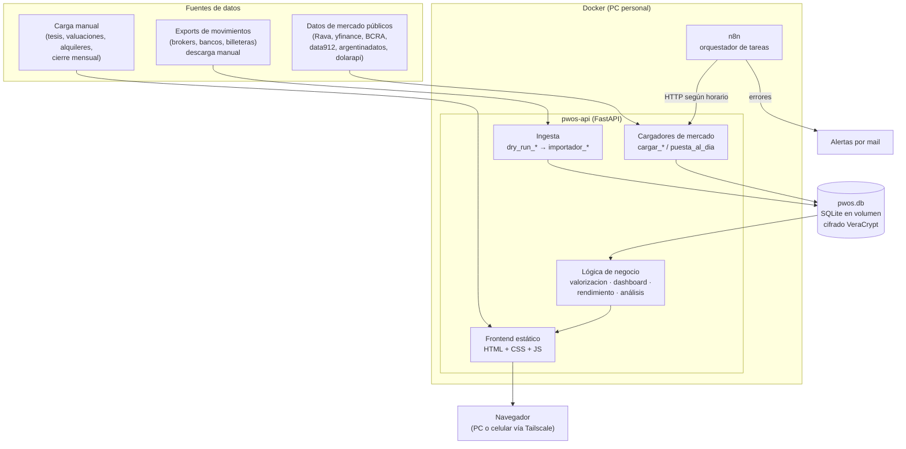

# Arquitectura general

> Cómo están conectadas las piezas del sistema: qué hace cada una y cómo se comunican.
> El vocabulario (contenedor, cuenta, movimiento…) está en el [modelo de dominio](modelo-de-dominio.md); las tablas, en el [schema de la base](schema-base-datos.md); y el porqué de cada decisión, en las [decisiones de arquitectura](../decisiones/README.md).

## En una frase

PWOS es una base **SQLite cifrada** con una **API en Python (FastAPI)** encima, que sirve un **dashboard web** y que **n8n** alimenta con datos de mercado según un horario. Todo corre en una PC personal dentro de **Docker** y solo se accede por una **red privada (Tailscale)**.

## Mapa de componentes



*(El diagrama se dibuja solo en GitHub y en Obsidian. Si se ve como texto, ver [cómo verlo](#cómo-ver-los-diagramas).)*

## Las piezas, una por una

### 1. Base de datos — `pwos.db`

- **SQLite, un solo archivo** ([ADR-002](../decisiones/adr/ADR-002-sqlite-archivo-unico.md)). Tiene más de 40 tablas y varias vistas; el detalle está en el [schema](schema-base-datos.md).
- Vive en un **volumen cifrado con VeraCrypt**, montado a mano con contraseña ([ADR-022](../decisiones/adr/ADR-022-cifrado-en-reposo-veracrypt.md)). No viaja dentro de la imagen de Docker: se monta como volumen, así el contenedor siempre ve el estado real.
- El sistema guarda **movimientos, no fotos** ([ADR-003](../decisiones/adr/ADR-003-movimientos-no-fotos.md)). Los saldos y las posiciones se calculan; no se cargan.
- Su estructura cambia solo mediante **migraciones versionadas** (`migrar_vNNN_*.py`), con backup previo y transacción ([ADR-014](../decisiones/adr/ADR-014-migraciones-de-schema-versionadas.md)).

### 2. Ingesta — de los exports a la base

Cada institución tiene su par de scripts:

| Script | Qué hace | ¿Escribe en la base? |
|---|---|---|
| `dry_run_<institucion>.py` | Lee el export más reciente de `descargas/AAAA-MM-DD/`, clasifica cada fila y muestra un reporte | **No** |
| `importador_<institucion>.py` | Inserta los movimientos nuevos (`importar_incremental`) | Sí, después de revisar el dry run |

Reglas que sigue la ingesta:

- **Ventana de fechas incremental:** solo se procesa lo nuevo, y cada fila lleva un `identificador_externo` para no duplicar ([ADR-012](../decisiones/adr/ADR-012-actualizacion-incremental.md)).
- **Mapas explícitos, no heurísticas:** si una fila no encaja en ninguna regla conocida, el proceso se frena y se pregunta; nunca adivina ([ADR-013](../decisiones/adr/ADR-013-mapas-explicitos-sobre-heuristicas.md)).
- **El juicio humano se queda humano:** n8n puede disparar un dry run, pero la inserción final la confirma una persona.
- Los contenedores que no tienen export (billeteras chicas, fondos de inversión inmobiliaria) se actualizan con un **movimiento de ajuste** ([ADR-024](../decisiones/adr/ADR-024-contenedores-sin-export.md)).

### 3. Cargadores de mercado

Scripts `cargar_*.py` que traen datos públicos: precios de acciones, CEDEARs, bonos y tipos de cambio; cronogramas de pago de bonos; universo de renta fija; indicadores macro; dividendos proyectados.

- Las cargas son **re-ejecutables** (`INSERT OR IGNORE` / UPSERT): correrlas dos veces no duplica datos.
- **`puesta_al_dia.py`** detecta los huecos que quedaron porque la PC estuvo apagada y los rellena desde la fuente. Si algo no se puede recuperar, lo registra en `puesta_al_dia_log` y avisa por mail.

### 4. Lógica de negocio

| Módulo | Responsabilidad |
|---|---|
| `valorizacion.py` | **Único lugar** donde se convierte una posición o un saldo a USD MEP y se aplica la parte propia de un contenedor compartido ([ADR-015](../decisiones/adr/ADR-015-valorizacion-centralizada.md), [ADR-001](../decisiones/adr/ADR-001-unidad-de-cuenta-dolar-mep.md), [ADR-032](../decisiones/adr/ADR-032-contenedores-compartidos.md)) |
| `dashboard.py` | Patrimonio, composición, ganancia realizada y no realizada |
| `rendimiento.py` | Rendimiento en el tiempo a partir del cierre mensual ([ADR-023](../decisiones/adr/ADR-023-curva-de-rendimiento-desde-cierre-mensual.md)) |
| `calendario_flujo.py`, `flujo_estimado.py` | Cobros esperados frente a cobros reales ([ADR-008](../decisiones/adr/ADR-008-flujos-esperados.md)) |
| Análisis de bonos, acciones, macro y Real Estate | Herramientas de **diagnóstico**, no de recomendación ([ADR-027](../decisiones/adr/ADR-027-analisis-como-diagnostico.md)) |

Si un número aparece en dos pantallas, sale de la misma función. Así no puede haber dos versiones del mismo cálculo.

### 5. API y dashboard — `pwos-api`

- **FastAPI** (`api.py`) expone endpoints `GET` de lectura y algunos `POST` puntuales: refrescar precios, guardar una tesis, disparar un dry run, etc. ([ADR-016](../decisiones/adr/ADR-016-dashboard-web-fastapi.md)).
- El **frontend** es HTML, CSS y JavaScript sin framework ni build (`static/`). Los gráficos se hacen con HTML/CSS puro, sin librerías de gráficos ni CDN.
- **Pestañas:** Dashboard · Análisis — Bonos · Análisis — Acciones · Indicadores Macro · Real Estate.
- Corre en un contenedor **Docker** con reinicio automático ([ADR-019](../decisiones/adr/ADR-019-docker-para-servicios.md)). Al arrancar, un *guard* (`docker-entrypoint.sh`) verifica que la base esté realmente montada. Si no lo está, el contenedor falla a propósito, en vez de arrancar "sano" sin datos.

### 6. Orquestación — n8n

n8n corre en su propio contenedor Docker ([ADR-018](../decisiones/adr/ADR-018-n8n-como-orquestador.md)) y llama a la API por HTTP según un horario:

| Tarea | Frecuencia |
|---|---|
| Universo de bonos | Cada 30 minutos |
| Puesta al día de huecos | Cada hora |
| Snapshot de cartera | Una vez por día (reintenta cada hora hasta lograrlo) |
| Indicadores macro | Diario, a la tarde |
| Precios de cierre y snapshot de bonos | Diario, después del cierre del mercado |
| Dry runs de los exports | Semanal |
| Indicadores mensuales | Una vez por mes |

Cualquier error en un workflow dispara un **mail de alerta**, como máximo uno cada 24 horas por el mismo error.

### 7. Seguridad e infraestructura

| Tema | Cómo se resuelve |
|---|---|
| Acceso remoto | Solo por **Tailscale**. Nada se expone a internet ([ADR-017](../decisiones/adr/ADR-017-acceso-remoto-por-tailscale.md)) |
| Credenciales | **Windows Credential Manager** vía `keyring`; nunca en archivos `.env` ([ADR-020](../decisiones/adr/ADR-020-credenciales-en-credential-manager.md)) |
| Cifrado en reposo | Volumen **VeraCrypt** ([ADR-022](../decisiones/adr/ADR-022-cifrado-en-reposo-veracrypt.md)) |
| APIs de brokers | Solo con usuario de **solo lectura**; si no existe, no se automatiza ([ADR-021](../decisiones/adr/ADR-021-automatizacion-con-brokers.md)) |
| Backups | Copia automática antes de cada migración o carga que escribe, dentro del volumen cifrado |
| Reinicio de la PC | Un script de un click (`recuperar_servicios`) deja todo funcionando y verifica cada servicio |

## Flujos principales

### Ronda incremental (aproximadamente semanal)

```
1. DESCARGA    Se bajan los exports de cada institución a descargas/AAAA-MM-DD/
2. DRY RUN     dry_run_<institucion>.py → reporte: filas nuevas, duplicados, sin clasificar
3. REVISIÓN    Una persona confirma contra la app real de la institución
4. CARGA       importador_<institucion>.py inserta solo lo nuevo
5. VERIFICACIÓN El saldo calculado tiene que coincidir con el saldo real de la institución
```

### Precios y datos de mercado (automático)

```
n8n (horario) → POST a la API → cargar_*.py → pwos.db
                                  └─ si la PC estuvo apagada: puesta_al_dia.py rellena el hueco
```

### Cierre mensual

```
1. A principio de mes se registra el patrimonio MEDIDO de cada contenedor
2. Se guarda una fila en cierres_mensuales
3. rendimiento.py separa:  Patrimonio(mes) = Patrimonio(mes-1) + Aportes(mes) + Rendimiento(mes)
4. Las valuaciones de Real Estate se actualizan en el mismo momento
```

## Cómo se aplica un cambio

En PWOS hay dos tipos de cambio, y conviene no confundirlos:

| Si cambió… | Qué hay que hacer |
|---|---|
| **La estructura de la base** (tabla o columna nueva) | Correr la migración `migrar_vNNN_*.py` y después regenerar el schema con `python database/generar_doc_schema.py` |
| **El código** que corre en el contenedor (`api.py`, módulos, `static/`) | Reconstruir la imagen (`docker build`) y recrear el contenedor `pwos-api` |
| **Solo datos** (una carga, una ronda) | Nada: la base está montada como volumen y el contenedor la ve en vivo |

Una funcionalidad nueva suele necesitar los dos primeros: la migración para guardar el dato y el rebuild para mostrarlo.

## Estructura del repositorio

```
pwos/
├── database/                 ← todo el código Python, plano (sin subpaquetes)
│   ├── api.py                ← API FastAPI
│   ├── valorizacion.py       ← valuación centralizada
│   ├── dashboard.py, rendimiento.py, …   ← lógica de negocio
│   ├── dry_run_*.py          ← diagnóstico de exports (no escriben)
│   ├── importador_*.py       ← carga de movimientos
│   ├── cargar_*.py           ← datos de mercado y cargas manuales
│   ├── migrar_vNNN_*.py      ← migraciones de schema
│   ├── create_schema.py, create_views.py
│   ├── generar_doc_schema.py ← genera docs/arquitectura/schema-base-datos.md
│   ├── static/               ← frontend (index.html, app.js, style.css)
│   ├── Dockerfile, docker-entrypoint.sh, requirements.txt
│   └── descargas/            ← exports crudos (ignorado por git)
│
└── docs/                     ← documentación publicable
    ├── arquitectura/         ← este documento, modelo de dominio, schema
    ├── decisiones/           ← ADRs
    ├── guias/
    └── glosario.md
```

La base de datos, los exports, las credenciales y la documentación personal **no se versionan en lo publicable** ([ADR-030](../decisiones/adr/ADR-030-separacion-docs-privado.md)).

## Cómo ver los diagramas

Los bloques ` ```mermaid ` se dibujan automáticamente en **GitHub** y en **Obsidian**. En VS Code hace falta la extensión *Markdown Preview Mermaid Support*. También se pueden pegar en [mermaid.live](https://mermaid.live).

---

## Links relacionados

- [Modelo de dominio](modelo-de-dominio.md)
- [Schema de la base de datos](schema-base-datos.md)
- [Decisiones de arquitectura](../decisiones/README.md)
- [Glosario](../glosario.md)
