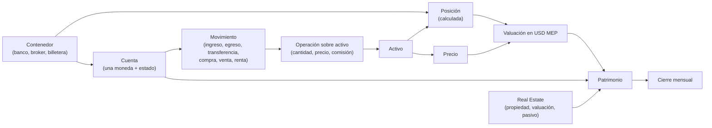

# Modelo de dominio

> El vocabulario exacto con el que PWOS piensa el patrimonio. Cada término tiene una sola definición; si hay dudas, este documento manda.
> Cómo se conectan las piezas técnicas está en la [arquitectura general](arquitectura-general.md), y las tablas, en el [schema](schema-base-datos.md).

## Por qué un modelo de dominio

Antes de escribir código hay que acordar qué significa cada palabra. "Cuenta" puede querer decir cinco cosas distintas según quién hable. En PWOS cada concepto tiene una definición única, y el código, la base y la interfaz la respetan.

**Todos los ejemplos de este documento son inventados.** Las instituciones se llaman "Banco A", "Broker B" y "Billetera C", y los montos son ilustrativos.

---

## Mapa de conceptos



---

## Núcleo patrimonial

### Contenedor

**Qué es:** cualquier institución o plataforma donde puede haber capital.

**Tipos:** `banco`, `broker`, `billetera_virtual`, `inmueble`, `otro`.

**Regla clave:** agregar un contenedor nuevo es cargar un registro; no requiere tocar código.

**Lo que NO es:** un activo. Una acción o un bono no son contenedores: se tienen *dentro* de un contenedor.

**Contenedores compartidos:** una cuenta que es solo en parte del usuario (por ejemplo, 50% con otra persona) tiene un `pct_propiedad`. Sus movimientos se cargan al 100%, para que el saldo coincida con la app, y el porcentaje se aplica al valuar y al sumar gastos o renta ([ADR-032](../decisiones/adr/ADR-032-contenedores-compartidos.md)).

**Contenedores sin export:** algunos no ofrecen descarga de movimientos (una billetera chica, un fondo de inversión inmobiliaria). Igual son patrimonio. Su valor se actualiza con un **movimiento de ajuste** contra el saldo real ([ADR-024](../decisiones/adr/ADR-024-contenedores-sin-export.md)).

---

### Cuenta

**Qué es:** la parte del efectivo de un contenedor que corresponde a **una sola moneda** y a **un estado**.

**Estados posibles:** `disponible`, `caucionado` (el efectivo prestado en una caución, [ADR-009](../decisiones/adr/ADR-009-cauciones-como-estado-del-efectivo.md)) y `plazo_fijo`.

**Ejemplo (inventado):**

```
Broker B
  ├── ARS / disponible
  ├── ARS / caucionado
  ├── USD / disponible
  ├── USD / caucionado
  └── USD_CCL / disponible   ← dólar cable de bonos ley extranjera (ADR-011)

Banco A
  ├── ARS / disponible
  └── ARS / plazo_fijo
```

**Reglas clave:**

- Una cuenta tiene exactamente una moneda.
- **El saldo siempre se calcula, nunca se carga:** `saldo = Σ(entradas a la cuenta) − Σ(salidas de la cuenta)` (vista `vista_saldos_cuenta`).
- Las cuentas guardan solo **efectivo**. Los títulos (acciones, bonos) pertenecen directamente al contenedor ([ADR-007](../decisiones/adr/ADR-007-tenencias-pertenecen-al-contenedor.md)).

---

### Movimiento

**Qué es:** cualquier evento que cambia algo en el patrimonio. Es la unidad básica del sistema: todo lo que pasa se registra como un movimiento ([ADR-003](../decisiones/adr/ADR-003-movimientos-no-fotos.md)).

**Tipos y esfera económica.** La esfera se deriva del tipo, sin columna aparte ([ADR-025](../decisiones/adr/ADR-025-esfera-economica-desde-tipo.md)):

| Tipo | Origen → Destino | Esfera | Efecto en el patrimonio |
|---|---|---|---|
| `ingreso` | exterior → cuenta propia | consumo | Sube |
| `egreso` | cuenta propia → exterior | consumo | Baja |
| `transferencia` | cuenta propia → cuenta propia | rebalanceo | Neutro |
| `compra_activo` | efectivo → activo | inversión | Neutro en el momento |
| `venta_activo` | activo → efectivo | inversión | Neutro en el momento |
| `renta` | exterior → cuenta propia (cupón, dividendo, interés) | renta pasiva | Sube |

Esta separación entre el **mundo del flujo** (consumo) y el **mundo de las inversiones** es central en el sistema ([ADR-004](../decisiones/adr/ADR-004-mundo-flujo-y-mundo-inversiones.md)).

**Naturaleza:** `efectivo` o `en_especie`. Un movimiento en especie mueve títulos sin mover plata, por ejemplo un traspaso de bonos entre brokers o un dividendo en acciones ([ADR-010](../decisiones/adr/ADR-010-movimientos-sin-efectivo.md)).

**Regla clave:** una transferencia entre cuentas propias **no es** ingreso ni egreso. Si se la cuenta como gasto, el ahorro real queda distorsionado.

**Ejemplos (inventados):**

```
Cobro de sueldo
  tipo: ingreso · destino: Banco A / ARS / disponible · monto: 1.000.000 ARS

Paso de pesos al broker
  tipo: transferencia · origen: Banco A / ARS · destino: Broker B / ARS · monto: 300.000 ARS

Cobro de cupón de un bono
  tipo: renta · destino: Broker B / USD / disponible · monto: 25 USD
```

Cada movimiento importado lleva un **`identificador_externo`**: el ID de la institución o un hash de su contenido. Sirve para que la misma fila nunca se cargue dos veces ([ADR-012](../decisiones/adr/ADR-012-actualizacion-incremental.md)).

---

### Operación sobre activo

**Qué es:** el detalle de un movimiento de compra o venta. Por cada uno de esos movimientos hay exactamente una operación.

**Qué agrega:** el activo, el **contenedor** donde queda la tenencia, la cantidad, el precio unitario, la moneda y la comisión.

---

### Activo

**Qué es:** un instrumento que se compra, se mantiene y se vende, y que tiene precio de mercado.

| Tipo | Ejemplos de la categoría | Grupo |
|---|---|---|
| `bono_soberano`, `bono_provincial`, `bono_cer`, `on`, `lecap` | Bonares/Globales, provinciales, bonos CER, obligaciones negociables, letras | Renta fija |
| `accion`, `cedear` | Acciones argentinas, CEDEARs | Renta variable |
| `fci`, `cripto` | Fondos comunes, criptomonedas | Otro |
| `fx` | `USD_MEP`, `USD_CCL`, `USD_A3500` | Tipos de cambio (se guardan como activos para tener su historial de precios) |
| `inmueble` | Activos con valuación manual | Otro |

En bonos, el precio se expresa **cada 100 de valor nominal**. Ese ajuste se aplica en un único lugar del código (ver Valuación).

---

### Posición

**Qué es:** la cantidad de un activo que hay en un contenedor en un momento dado. **Siempre se calcula** (vista `vista_posiciones`):

`posición = Σ compras − Σ ventas ± transferencias en especie ± eventos corporativos`

Los **splits y contrasplits** son un evento propio (`eventos_corporativos`): cambian la cantidad sin cambiar el costo ni generar ganancia ([ADR-029](../decisiones/adr/ADR-029-splits-como-evento.md)).

**Nunca se carga una posición a mano.** Si no coincide con la del broker, falta registrar algún movimiento.

---

### Precio

**Qué es:** el valor de mercado de un activo en una fecha. Se guarda el historial completo, así se puede valuar la cartera en cualquier fecha pasada.

Los tipos de cambio también son precios (de los activos `fx`). Eso permite convertir cualquier monto con la cotización **del día en que ocurrió**.

---

### Valuación

**Qué es:** cuánto vale una posición o un saldo, expresado en la **unidad de cuenta del sistema: el dólar MEP** ([ADR-001](../decisiones/adr/ADR-001-unidad-de-cuenta-dolar-mep.md)).

`valuación = posición × precio ÷ tipo de cambio que corresponda`

**Reglas clave:**

- Se calcula en **un único módulo** (`valorizacion.py`); ninguna pantalla rearma la cuenta por su lado ([ADR-015](../decisiones/adr/ADR-015-valorizacion-centralizada.md)).
- **Excepción:** los retornos de renta variable se miden en el dólar de origen del activo ([ADR-028](../decisiones/adr/ADR-028-retornos-rv-en-usd.md)).

---

### Patrimonio

`patrimonio = Σ saldos de efectivo (× parte propia del contenedor) + Σ posiciones valuadas + Real Estate (parte propia) − pasivos (parte propia)`

Todo expresado en USD MEP.

---

### Cierre mensual

**Qué es:** una foto del patrimonio **medido** al principio de cada mes, contenedor por contenedor. Es la base de la curva de rendimiento ([ADR-023](../decisiones/adr/ADR-023-curva-de-rendimiento-desde-cierre-mensual.md)).

**La ecuación central:**

```
Patrimonio(mes) = Patrimonio(mes − 1) + Aportes(mes) + Rendimiento(mes)

Aportes(mes)     = lo que entró menos lo que salió del patrimonio
                   (ingresos − egresos; las transferencias internas no cuentan)
Rendimiento(mes) = lo que cambió el valor por mercado
```

Separar **aportes** de **rendimiento** es la distinción más importante del sistema. Es lo que permite saber si el patrimonio creció por ahorrar más o porque las inversiones rindieron.

**Regla clave:** una compra grande de consumo (un auto, por ejemplo) es un **egreso**, no una pérdida de inversión. Baja los aportes, no el rendimiento.

---

## Flujos de fondos

### Flujo esperado

**Qué es:** un cobro **estimado** a futuro: cupón o amortización de un bono, dividendo o alquiler. Cuando el cobro llega, se compara contra lo real ([ADR-008](../decisiones/adr/ADR-008-flujos-esperados.md)).

**De dónde sale la estimación:**

| Origen | De qué se trata |
|---|---|
| `cronograma` | Cronograma de pagos de cada bono |
| `yfinance` | Dividendos proyectados |
| `alquiler` | Contrato vigente de cada propiedad |
| `manual` | Carga manual |

Es lo que responde **"¿cuánto me va a entrar y cuándo?"**.

---

## Real Estate y pasivos

| Concepto | Qué es |
|---|---|
| **Propiedad** | Un inmueble físico (`activo_fisico`) o un fondo inmobiliario (`fondo_re`). Tiene un `pct_propiedad`: qué porcentaje es propio. |
| **Valuación** | Tasación de la propiedad en una fecha, **siempre al 100%**. El porcentaje propio se aplica al leer. Se actualiza en el cierre mensual. |
| **Alquiler** | Renta cobrada por período, ya **neta** de la parte propia. |
| **Gasto de propiedad** | Mantenimiento o impuesto, neto de la parte propia. |
| **Pasivo** | Una deuda puntual, opcionalmente asociada a una propiedad. Su saldo (original menos pagos) se resta del patrimonio. |

**Regla de co-propiedad:** el valor, la renta y la deuda usan el mismo porcentaje, y cada dato se guarda una sola vez en una sola convención ([ADR-026](../decisiones/adr/ADR-026-co-propiedad.md)).

Un fondo inmobiliario ya está contado por su cuenta de efectivo. Su valuación **no** se suma otra vez, para no duplicarlo.

---

## Tesis e indicadores

| Concepto | Qué es |
|---|---|
| **Tesis de inversión** | Por qué se tiene una posición: motivo, riesgos, horizonte, precio objetivo y criterio de venta. Hay bitácoras cronológicas por área (cartera, bonos, acciones, inmuebles). Una tesis se **cierra con una reflexión**; no se borra. |
| **Umbral de tesis** | Una condición medible atada a una tesis (por ejemplo, *"si el indicador X supera Y → revisar"*). Se chequea sola contra los datos cargados. |
| **Indicador de tesis** | Lo que tiene que seguir siendo verdad para una posición de renta variable, con semáforo verde/amarillo/rojo y su historial de lecturas. |
| **Indicador macro** | Una serie del catálogo (`indicadores_catalogo`) con historial completo, umbral y objetivo opcionales. |

**Principio rector:** el análisis **diagnostica**, no recomienda. El sistema muestra datos e interpreta; la decisión es siempre humana ([ADR-027](../decisiones/adr/ADR-027-analisis-como-diagnostico.md)).

---

## El recorrido completo

```
MUNDO EXTERIOR
      │  ingreso (sueldo, alquiler)           renta (cupones, dividendos)
      ▼                                              ▲
┌──────────────────────────────┐                     │
│  CUENTAS DE LIQUIDEZ         │                     │
│  bancos · billeteras         │                     │
└──────────────────────────────┘                     │
      │  transferencia (neutra)                      │
      ▼                                              │
┌──────────────────────────────┐   compra_activo     │
│  CUENTAS DE BROKERS          │ ──────────────────► │
│  efectivo por moneda/estado  │ ◄────────────────── │
└──────────────────────────────┘   venta_activo      │
                                                     │
┌──────────────────────────────────────────────────────┐
│  POSICIONES (por contenedor)                         │
│  renta fija · renta variable · otros                 │
└──────────────────────────────────────────────────────┘
      │  × precio ÷ tipo de cambio  (valorizacion.py)
      ▼
┌──────────────────────────────────────────────────────┐
│  PATRIMONIO EN USD MEP                               │
│  + Real Estate (parte propia) − pasivos              │
└──────────────────────────────────────────────────────┘
      │  foto mensual medida
      ▼
  CIERRE MENSUAL → aportes vs. rendimiento
```

---

## Links relacionados

- [Arquitectura general](arquitectura-general.md)
- [Schema de la base de datos](schema-base-datos.md)
- [Decisiones de arquitectura](../decisiones/README.md)
- [Glosario](../glosario.md)
