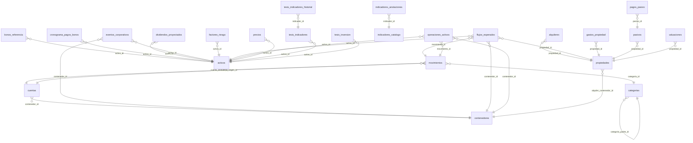

# Schema de base de datos

> ⚠️ **Archivo generado automáticamente** por `database/generar_doc_schema.py`.
> No editar a mano: los cambios se pierden la próxima vez que se genere.
> Para actualizarlo, correr el script después de cada migración y commitear el resultado.

**Resumen:** 42 tablas · 6 vistas · 29 relaciones (foreign keys).

El porqué de las decisiones de diseño está en [las decisiones de arquitectura](../decisiones/README.md).

## Diagrama de relaciones

Solo muestra las tablas que tienen relaciones declaradas con otras.

## Índice de tablas

- [activos](#activos)
- [alquileres](#alquileres)
- [benchmarks_macro](#benchmarks_macro)
- [bonos_referencia](#bonos_referencia)
- [categorias](#categorias)
- [cierres_mensuales](#cierres_mensuales)
- [contenedores](#contenedores)
- [cronograma_pagos_bonos](#cronograma_pagos_bonos)
- [cuentas](#cuentas)
- [dividendos_proyectados](#dividendos_proyectados)
- [eventos_corporativos](#eventos_corporativos)
- [factores_riesgo](#factores_riesgo)
- [flujos_esperados](#flujos_esperados)
- [fundamentales_rv](#fundamentales_rv)
- [gastos_propiedad](#gastos_propiedad)
- [indicadores_anotaciones](#indicadores_anotaciones)
- [indicadores_catalogo](#indicadores_catalogo)
- [macro_historico](#macro_historico)
- [maquina_fases](#maquina_fases)
- [mercado_renta_fija_historico](#mercado_renta_fija_historico)
- [mercado_renta_fija_rava](#mercado_renta_fija_rava)
- [movimientos](#movimientos)
- [operaciones_activos](#operaciones_activos)
- [pagos_pasivo](#pagos_pasivo)
- [parametros_rv](#parametros_rv)
- [pasivos](#pasivos)
- [precios](#precios)
- [precios_candidatas](#precios_candidatas)
- [propiedades](#propiedades)
- [puesta_al_dia_log](#puesta_al_dia_log)
- [ratios_cedear](#ratios_cedear)
- [simulaciones_compra_rv](#simulaciones_compra_rv)
- [tesis_acciones](#tesis_acciones)
- [tesis_bonos](#tesis_bonos)
- [tesis_cartera](#tesis_cartera)
- [tesis_indicadores](#tesis_indicadores)
- [tesis_indicadores_historial](#tesis_indicadores_historial)
- [tesis_inmuebles](#tesis_inmuebles)
- [tesis_inversion](#tesis_inversion)
- [tesis_umbrales](#tesis_umbrales)
- [valuaciones](#valuaciones)
- [watchlist_rv](#watchlist_rv)

## Tablas

### activos

| Columna | Tipo | Obligatoria | Default | Clave primaria |
|---|---|---|---|---|
| `id` | INTEGER |  |  | ✓ |
| `ticker` | TEXT | sí |  |  |
| `nombre` | TEXT |  |  |  |
| `tipo` | TEXT | sí |  |  |
| `moneda_nominal` | TEXT | sí |  |  |
| `creado_en` | TIMESTAMP | sí | CURRENT_TIMESTAMP |  |

### alquileres

| Columna | Tipo | Obligatoria | Default | Clave primaria |
|---|---|---|---|---|
| `id` | INTEGER |  |  | ✓ |
| `propiedad_id` | INTEGER | sí |  |  |
| `periodo` | TEXT | sí |  |  |
| `monto` | REAL | sí |  |  |
| `moneda` | TEXT | sí |  |  |
| `monto_usd` | REAL | sí |  |  |
| `fecha_cobro` | DATE | sí |  |  |
| `creado_en` | TIMESTAMP | sí | CURRENT_TIMESTAMP |  |

**Relaciones:**

- `propiedad_id` → `propiedades.id`

### benchmarks_macro

| Columna | Tipo | Obligatoria | Default | Clave primaria |
|---|---|---|---|---|
| `clave` | TEXT |  |  | ✓ |
| `valor_pct` | REAL |  |  |  |
| `fecha_dato` | DATE | sí |  |  |
| `fuente` | TEXT | sí |  |  |
| `actualizado_en` | TIMESTAMP | sí | CURRENT_TIMESTAMP |  |
| `detalle_json` | TEXT |  |  |  |

### bonos_referencia

| Columna | Tipo | Obligatoria | Default | Clave primaria |
|---|---|---|---|---|
| `activo_id` | INTEGER |  |  | ✓ |
| `nombre` | TEXT |  |  |  |
| `tipo_instrumento` | TEXT |  |  |  |
| `legislacion` | TEXT |  |  |  |
| `es_dolar` | INTEGER |  |  |  |
| `fuente` | TEXT | sí | 'rava' |  |
| `actualizado_en` | TIMESTAMP | sí | CURRENT_TIMESTAMP |  |
| `moneda_pago` | TEXT |  |  |  |

**Relaciones:**

- `activo_id` → `activos.id`

### categorias

| Columna | Tipo | Obligatoria | Default | Clave primaria |
|---|---|---|---|---|
| `id` | INTEGER |  |  | ✓ |
| `nombre` | TEXT | sí |  |  |
| `categoria_padre_id` | INTEGER |  |  |  |
| `tipo` | TEXT |  |  |  |

**Relaciones:**

- `categoria_padre_id` → `categorias.id`

### cierres_mensuales

| Columna | Tipo | Obligatoria | Default | Clave primaria |
|---|---|---|---|---|
| `id` | INTEGER |  |  | ✓ |
| `anio` | INTEGER | sí |  |  |
| `mes` | INTEGER | sí |  |  |
| `patrimonio_total_usd` | REAL | sí |  |  |
| `aportes_netos_usd` | REAL | sí | 0 |  |
| `rendimiento_usd` | REAL | sí | 0 |  |
| `detalle_json` | TEXT |  |  |  |
| `generado_en` | TIMESTAMP | sí | CURRENT_TIMESTAMP |  |

### contenedores

| Columna | Tipo | Obligatoria | Default | Clave primaria |
|---|---|---|---|---|
| `id` | INTEGER |  |  | ✓ |
| `nombre` | TEXT | sí |  |  |
| `tipo` | TEXT | sí |  |  |
| `activo` | INTEGER | sí | 1 |  |
| `notas` | TEXT |  |  |  |
| `creado_en` | TIMESTAMP | sí | CURRENT_TIMESTAMP |  |
| `pct_propiedad` | REAL | sí | 100 |  |

### cronograma_pagos_bonos

| Columna | Tipo | Obligatoria | Default | Clave primaria |
|---|---|---|---|---|
| `id` | INTEGER |  |  | ✓ |
| `activo_id` | INTEGER | sí |  |  |
| `fecha_pago` | DATE | sí |  |  |
| `tipo_pago` | TEXT | sí |  |  |
| `monto_por_vn` | REAL | sí |  |  |
| `fuente` | TEXT | sí | 'rava' |  |
| `actualizado_en` | TIMESTAMP | sí | CURRENT_TIMESTAMP |  |

**Relaciones:**

- `activo_id` → `activos.id`

### cuentas

| Columna | Tipo | Obligatoria | Default | Clave primaria |
|---|---|---|---|---|
| `id` | INTEGER |  |  | ✓ |
| `contenedor_id` | INTEGER | sí |  |  |
| `moneda` | TEXT | sí |  |  |
| `estado` | TEXT | sí | 'disponible' |  |
| `alias` | TEXT |  |  |  |
| `activa` | INTEGER | sí | 1 |  |
| `creado_en` | TIMESTAMP | sí | CURRENT_TIMESTAMP |  |

**Relaciones:**

- `contenedor_id` → `contenedores.id`

### dividendos_proyectados

| Columna | Tipo | Obligatoria | Default | Clave primaria |
|---|---|---|---|---|
| `activo_id` | INTEGER | sí |  | ✓ |
| `simbolo` | TEXT | sí |  |  |
| `fecha_ex` | DATE | sí |  | ✓ |
| `fecha_pago` | DATE | sí |  |  |
| `monto_por_accion` | REAL | sí |  |  |
| `moneda` | TEXT | sí |  |  |
| `tipo` | TEXT | sí |  |  |
| `actualizado_en` | TIMESTAMP | sí |  |  |

**Relaciones:**

- `activo_id` → `activos.id`

### eventos_corporativos

| Columna | Tipo | Obligatoria | Default | Clave primaria |
|---|---|---|---|---|
| `id` | INTEGER |  |  | ✓ |
| `activo_id` | INTEGER | sí |  |  |
| `contenedor_id` | INTEGER | sí |  |  |
| `fecha` | DATE | sí |  |  |
| `tipo` | TEXT | sí |  |  |
| `ratio_viejas` | REAL | sí |  |  |
| `ratio_nuevas` | REAL | sí |  |  |
| `cantidad_antes` | REAL | sí |  |  |
| `cantidad_despues` | REAL | sí |  |  |
| `descripcion` | TEXT |  |  |  |
| `creado_en` | TIMESTAMP | sí | CURRENT_TIMESTAMP |  |

**Relaciones:**

- `contenedor_id` → `contenedores.id`
- `activo_id` → `activos.id`

### factores_riesgo

| Columna | Tipo | Obligatoria | Default | Clave primaria |
|---|---|---|---|---|
| `activo_id` | INTEGER |  |  | ✓ |
| `beta` | REAL |  |  |  |
| `deuda_patrimonio` | REAL |  |  |  |
| `fuente` | TEXT | sí | 'yfinance' |  |
| `actualizado_en` | TIMESTAMP | sí | CURRENT_TIMESTAMP |  |

**Relaciones:**

- `activo_id` → `activos.id`

### flujos_esperados

| Columna | Tipo | Obligatoria | Default | Clave primaria |
|---|---|---|---|---|
| `id` | INTEGER |  |  | ✓ |
| `activo_id` | INTEGER |  |  |  |
| `propiedad_id` | INTEGER |  |  |  |
| `contenedor_id` | INTEGER |  |  |  |
| `tipo_flujo` | TEXT | sí |  |  |
| `fecha_estimada` | DATE | sí |  |  |
| `monto_estimado` | REAL | sí |  |  |
| `moneda` | TEXT | sí |  |  |
| `monto_estimado_usd` | REAL |  |  |  |
| `origen_estimado` | TEXT | sí | 'importador' |  |
| `estimado_en` | TIMESTAMP |  |  |  |
| `estado` | TEXT | sí | 'pendiente' |  |
| `movimiento_id` | INTEGER |  |  |  |
| `notas` | TEXT |  |  |  |
| `creado_en` | TIMESTAMP | sí | CURRENT_TIMESTAMP |  |

**Relaciones:**

- `movimiento_id` → `movimientos.id`
- `contenedor_id` → `contenedores.id`
- `propiedad_id` → `propiedades.id`
- `activo_id` → `activos.id`

### fundamentales_rv

| Columna | Tipo | Obligatoria | Default | Clave primaria |
|---|---|---|---|---|
| `ticker` | TEXT |  |  | ✓ |
| `simbolo_yahoo` | TEXT | sí |  |  |
| `nombre` | TEXT |  |  |  |
| `tipo_instrumento` | TEXT |  |  |  |
| `fecha_dato` | DATE |  |  |  |
| `fuente` | TEXT |  |  |  |
| `sector` | TEXT |  |  |  |
| `industria` | TEXT |  |  |  |
| `moneda_cotizacion` | TEXT |  |  |  |
| `moneda_estados` | TEXT |  |  |  |
| `precio_subyacente_usd` | REAL |  |  |  |
| `per` | REAL |  |  |  |
| `per_forward` | REAL |  |  |  |
| `pb` | REAL |  |  |  |
| `current_ratio` | REAL |  |  |  |
| `deuda_neta_ebitda` | REAL |  |  |  |
| `cobertura_intereses` | REAL |  |  |  |
| `roic` | REAL |  |  |  |
| `fcf_yield` | REAL |  |  |  |
| `eps_ttm` | REAL |  |  |  |
| `bvps` | REAL |  |  |  |
| `anios_dividendo_sin_recorte` | INTEGER |  |  |  |
| `anios_estados` | INTEGER |  |  |  |
| `series_json` | TEXT |  |  |  |
| `campos_no_verificados` | TEXT |  |  |  |
| `actualizado_en` | TIMESTAMP | sí | CURRENT_TIMESTAMP |  |

### gastos_propiedad

| Columna | Tipo | Obligatoria | Default | Clave primaria |
|---|---|---|---|---|
| `id` | INTEGER |  |  | ✓ |
| `propiedad_id` | INTEGER | sí |  |  |
| `fecha` | DATE | sí |  |  |
| `tipo` | TEXT | sí |  |  |
| `monto_usd` | REAL | sí |  |  |
| `concepto` | TEXT |  |  |  |
| `creado_en` | TIMESTAMP | sí | CURRENT_TIMESTAMP |  |

**Relaciones:**

- `propiedad_id` → `propiedades.id`

### indicadores_anotaciones

| Columna | Tipo | Obligatoria | Default | Clave primaria |
|---|---|---|---|---|
| `indicador_id` | TEXT |  |  | ✓ |
| `umbral_valor` | REAL |  |  |  |
| `umbral_direccion` | TEXT |  |  |  |
| `objetivo_valor` | REAL |  |  |  |
| `nota` | TEXT |  |  |  |
| `actualizado` | TIMESTAMP | sí | CURRENT_TIMESTAMP |  |
| `umbral_d3m_valor` | REAL |  |  |  |
| `umbral_d3m_direccion` | TEXT |  |  |  |

**Relaciones:**

- `indicador_id` → `indicadores_catalogo.id`

### indicadores_catalogo

| Columna | Tipo | Obligatoria | Default | Clave primaria |
|---|---|---|---|---|
| `id` | TEXT |  |  | ✓ |
| `nombre` | TEXT | sí |  |  |
| `seccion` | TEXT | sí |  |  |
| `unidad` | TEXT | sí |  |  |
| `tipo_delta` | TEXT | sí |  |  |
| `frecuencia` | TEXT | sí |  |  |
| `fuente` | TEXT | sí |  |  |
| `serie_origen` | TEXT | sí |  |  |
| `prioridad` | INTEGER | sí |  |  |
| `activo` | INTEGER | sí | 1 |  |
| `orden` | INTEGER | sí |  |  |
| `clave_benchmark` | TEXT |  |  |  |
| `decimales` | INTEGER | sí | 2 |  |
| `semaforo` | TEXT |  |  |  |

### macro_historico

| Columna | Tipo | Obligatoria | Default | Clave primaria |
|---|---|---|---|---|
| `id` | INTEGER |  |  | ✓ |
| `clave` | TEXT | sí |  |  |
| `fecha` | DATE | sí |  |  |
| `valor` | REAL | sí |  |  |
| `creado_en` | TIMESTAMP | sí | CURRENT_TIMESTAMP |  |
| `actualizado_en` | TIMESTAMP |  |  |  |

### maquina_fases

| Columna | Tipo | Obligatoria | Default | Clave primaria |
|---|---|---|---|---|
| `id` | INTEGER |  |  | ✓ |
| `semaforo` | TEXT | sí |  |  |
| `fecha` | DATE | sí |  |  |
| `fase` | TEXT | sí |  |  |
| `creado_en` | TIMESTAMP | sí | CURRENT_TIMESTAMP |  |

### mercado_renta_fija_historico

| Columna | Tipo | Obligatoria | Default | Clave primaria |
|---|---|---|---|---|
| `id` | INTEGER |  |  | ✓ |
| `ticker` | TEXT | sí |  |  |
| `fecha` | DATE | sí |  |  |
| `categoria` | TEXT |  |  |  |
| `moneda` | TEXT |  |  |  |
| `tir_pct` | REAL |  |  |  |
| `precio_vn100` | REAL |  |  |  |
| `paridad_pct` | REAL |  |  |  |
| `duration` | REAL |  |  |  |
| `carry_pct` | REAL |  |  |  |
| `bpv_usd` | REAL |  |  |  |
| `breakeven_pb` | REAL |  |  |  |
| `en_cartera` | INTEGER | sí | 0 |  |
| `creado_en` | TIMESTAMP | sí | CURRENT_TIMESTAMP |  |
| `origen` | TEXT | sí | 'snapshot' |  |

### mercado_renta_fija_rava

| Columna | Tipo | Obligatoria | Default | Clave primaria |
|---|---|---|---|---|
| `ticker` | TEXT |  |  | ✓ |
| `nombre` | TEXT |  |  |  |
| `tipo_instrumento` | TEXT |  |  |  |
| `legislacion` | TEXT |  |  |  |
| `tir` | REAL |  |  |  |
| `duration` | REAL |  |  |  |
| `vencimiento` | DATE |  |  |  |
| `fuente` | TEXT | sí | 'rava' |  |
| `actualizado_en` | TIMESTAMP | sí | CURRENT_TIMESTAMP |  |
| `paridad` | REAL |  |  |  |
| `valor_tecnico` | REAL |  |  |  |
| `precio` | REAL |  |  |  |
| `dm` | REAL |  |  |  |
| `convexity` | REAL |  |  |  |
| `current_yield` | REAL |  |  |  |
| `descripcion` | TEXT |  |  |  |
| `emisor` | TEXT |  |  |  |
| `isin` | TEXT |  |  |  |
| `moneda_especie` | TEXT |  |  |  |
| `precio_limpio_vn100` | REAL |  |  |  |
| `paridad_calc` | REAL |  |  |  |
| `current_yield_calc` | REAL |  |  |  |
| `enriquecido_en` | TIMESTAMP |  |  |  |

### movimientos

| Columna | Tipo | Obligatoria | Default | Clave primaria |
|---|---|---|---|---|
| `id` | INTEGER |  |  | ✓ |
| `fecha` | DATE | sí |  |  |
| `tipo` | TEXT | sí |  |  |
| `cuenta_origen_id` | INTEGER |  |  |  |
| `cuenta_destino_id` | INTEGER |  |  |  |
| `monto` | REAL | sí |  |  |
| `moneda` | TEXT | sí |  |  |
| `categoria_id` | INTEGER |  |  |  |
| `descripcion` | TEXT |  |  |  |
| `naturaleza` | TEXT | sí | 'efectivo' |  |
| `creado_en` | TIMESTAMP | sí | CURRENT_TIMESTAMP |  |
| `identificador_externo` | TEXT |  |  |  |

**Relaciones:**

- `categoria_id` → `categorias.id`
- `cuenta_destino_id` → `cuentas.id`
- `cuenta_origen_id` → `cuentas.id`

### operaciones_activos

| Columna | Tipo | Obligatoria | Default | Clave primaria |
|---|---|---|---|---|
| `id` | INTEGER |  |  | ✓ |
| `movimiento_id` | INTEGER | sí |  |  |
| `activo_id` | INTEGER | sí |  |  |
| `contenedor_id` | INTEGER | sí |  |  |
| `cantidad` | REAL | sí |  |  |
| `precio_unitario` | REAL | sí |  |  |
| `moneda` | TEXT | sí |  |  |
| `comision` | REAL | sí | 0 |  |

**Relaciones:**

- `contenedor_id` → `contenedores.id`
- `activo_id` → `activos.id`
- `movimiento_id` → `movimientos.id`

### pagos_pasivo

| Columna | Tipo | Obligatoria | Default | Clave primaria |
|---|---|---|---|---|
| `id` | INTEGER |  |  | ✓ |
| `pasivo_id` | INTEGER | sí |  |  |
| `fecha` | DATE | sí |  |  |
| `monto_usd` | REAL | sí |  |  |
| `creado_en` | TIMESTAMP | sí | CURRENT_TIMESTAMP |  |

**Relaciones:**

- `pasivo_id` → `pasivos.id`

### parametros_rv

| Columna | Tipo | Obligatoria | Default | Clave primaria |
|---|---|---|---|---|
| `clave` | TEXT |  |  | ✓ |
| `valor` | REAL |  |  |  |
| `descripcion` | TEXT | sí |  |  |

### pasivos

| Columna | Tipo | Obligatoria | Default | Clave primaria |
|---|---|---|---|---|
| `id` | INTEGER |  |  | ✓ |
| `alias` | TEXT | sí |  |  |
| `monto_original_usd` | REAL | sí |  |  |
| `propiedad_id` | INTEGER |  |  |  |
| `fecha_alta` | DATE | sí |  |  |
| `creado_en` | TIMESTAMP | sí | CURRENT_TIMESTAMP |  |

**Relaciones:**

- `propiedad_id` → `propiedades.id`

### precios

| Columna | Tipo | Obligatoria | Default | Clave primaria |
|---|---|---|---|---|
| `id` | INTEGER |  |  | ✓ |
| `activo_id` | INTEGER | sí |  |  |
| `fecha` | DATE | sí |  |  |
| `precio` | REAL | sí |  |  |
| `moneda` | TEXT | sí |  |  |
| `fuente` | TEXT |  |  |  |

**Relaciones:**

- `activo_id` → `activos.id`

### precios_candidatas

| Columna | Tipo | Obligatoria | Default | Clave primaria |
|---|---|---|---|---|
| `ticker` | TEXT | sí |  | ✓ |
| `fecha` | DATE | sí |  | ✓ |
| `cierre_usd` | REAL | sí |  |  |
| `actualizado_en` | TIMESTAMP | sí | CURRENT_TIMESTAMP |  |

### propiedades

| Columna | Tipo | Obligatoria | Default | Clave primaria |
|---|---|---|---|---|
| `id` | INTEGER |  |  | ✓ |
| `alias` | TEXT | sí |  |  |
| `tipo` | TEXT | sí |  |  |
| `pct_propiedad` | REAL | sí |  |  |
| `fecha_alta` | DATE | sí |  |  |
| `fecha_disponibilidad_capital` | DATE |  |  |  |
| `notas` | TEXT |  |  |  |
| `creado_en` | TIMESTAMP | sí | CURRENT_TIMESTAMP |  |
| `actualizado_en` | TIMESTAMP | sí | CURRENT_TIMESTAMP |  |
| `inversion_inicial_usd` | REAL |  |  |  |
| `alquiler_monto` | REAL |  |  |  |
| `alquiler_moneda` | TEXT |  |  |  |
| `alquiler_dia_cobro` | INTEGER |  |  |  |
| `alquiler_contenedor_id` | INTEGER |  |  |  |
| `alquiler_desde` | DATE |  |  |  |

**Relaciones:**

- `alquiler_contenedor_id` → `contenedores.id`

### puesta_al_dia_log

| Columna | Tipo | Obligatoria | Default | Clave primaria |
|---|---|---|---|---|
| `id` | INTEGER |  |  | ✓ |
| `ejecucion` | TEXT | sí |  |  |
| `tarea` | TEXT | sí |  |  |
| `accion` | TEXT | sí |  |  |
| `fecha_dato` | DATE |  |  |  |
| `filas` | INTEGER | sí | 0 |  |
| `fuente` | TEXT |  |  |  |
| `detalle` | TEXT |  |  |  |
| `creado_en` | TIMESTAMP | sí | CURRENT_TIMESTAMP |  |

### ratios_cedear

| Columna | Tipo | Obligatoria | Default | Clave primaria |
|---|---|---|---|---|
| `ticker_byma` | TEXT |  |  | ✓ |
| `ticker_origen` | TEXT | sí |  |  |
| `nombre` | TEXT |  |  |  |
| `mercado_origen` | TEXT |  |  |  |
| `ratio_cedear` | REAL | sí |  |  |
| `ratio_subyacente` | REAL | sí |  |  |
| `ratio` | REAL | sí |  |  |
| `isin_cedear` | TEXT |  |  |  |
| `isin_subyacente` | TEXT |  |  |  |
| `tipo` | TEXT |  |  |  |
| `pais` | TEXT |  |  |  |
| `industria` | TEXT |  |  |  |
| `emisor` | TEXT |  |  |  |
| `nota` | TEXT |  |  |  |
| `fuente_ratio` | TEXT | sí |  |  |
| `fecha_lista` | DATE | sí |  |  |
| `actualizado_en` | TIMESTAMP | sí | CURRENT_TIMESTAMP |  |

### simulaciones_compra_rv

| Columna | Tipo | Obligatoria | Default | Clave primaria |
|---|---|---|---|---|
| `id` | INTEGER |  |  | ✓ |
| `fecha` | TIMESTAMP | sí | CURRENT_TIMESTAMP |  |
| `ticker` | TEXT | sí |  |  |
| `monto_usd` | REAL | sí |  |  |
| `fuente_fondos` | TEXT | sí |  |  |
| `resultado_json` | TEXT | sí |  |  |

### tesis_acciones

| Columna | Tipo | Obligatoria | Default | Clave primaria |
|---|---|---|---|---|
| `id` | INTEGER |  |  | ✓ |
| `ticker` | TEXT |  |  |  |
| `fecha` | DATE | sí |  |  |
| `tesis` | TEXT | sí |  |  |
| `riesgos` | TEXT |  |  |  |
| `conviccion` | TEXT |  |  |  |
| `estado` | TEXT | sí | 'vigente' |  |
| `reflexion_final` | TEXT |  |  |  |
| `fecha_reflexion` | DATE |  |  |  |
| `creado_en` | TIMESTAMP | sí | CURRENT_TIMESTAMP |  |
| `actualizado_en` | TIMESTAMP | sí | CURRENT_TIMESTAMP |  |

### tesis_bonos

| Columna | Tipo | Obligatoria | Default | Clave primaria |
|---|---|---|---|---|
| `id` | INTEGER |  |  | ✓ |
| `ticker` | TEXT |  |  |  |
| `fecha` | DATE | sí |  |  |
| `tesis` | TEXT | sí |  |  |
| `riesgos` | TEXT |  |  |  |
| `conviccion` | TEXT |  |  |  |
| `estado` | TEXT | sí | 'vigente' |  |
| `reflexion_final` | TEXT |  |  |  |
| `fecha_reflexion` | DATE |  |  |  |
| `creado_en` | TIMESTAMP | sí | CURRENT_TIMESTAMP |  |
| `actualizado_en` | TIMESTAMP | sí | CURRENT_TIMESTAMP |  |

### tesis_cartera

| Columna | Tipo | Obligatoria | Default | Clave primaria |
|---|---|---|---|---|
| `id` | INTEGER |  |  | ✓ |
| `fecha` | DATE | sí |  |  |
| `tesis` | TEXT | sí |  |  |
| `riesgos` | TEXT |  |  |  |
| `conviccion` | TEXT |  |  |  |
| `estado` | TEXT | sí | 'vigente' |  |
| `reflexion_final` | TEXT |  |  |  |
| `fecha_reflexion` | DATE |  |  |  |
| `creado_en` | TIMESTAMP | sí | CURRENT_TIMESTAMP |  |
| `actualizado_en` | TIMESTAMP | sí | CURRENT_TIMESTAMP |  |

### tesis_indicadores

| Columna | Tipo | Obligatoria | Default | Clave primaria |
|---|---|---|---|---|
| `id` | INTEGER |  |  | ✓ |
| `activo_id` | INTEGER | sí |  |  |
| `nombre` | TEXT | sí |  |  |
| `fuente` | TEXT |  |  |  |
| `frecuencia` | TEXT |  |  |  |
| `direccion` | TEXT | sí |  |  |
| `umbral_verde` | REAL | sí |  |  |
| `umbral_rojo` | REAL | sí |  |  |
| `activo` | INTEGER | sí | 1 |  |
| `creado_en` | TIMESTAMP | sí | CURRENT_TIMESTAMP |  |
| `actualizado_en` | TIMESTAMP | sí | CURRENT_TIMESTAMP |  |

**Relaciones:**

- `activo_id` → `activos.id`

### tesis_indicadores_historial

| Columna | Tipo | Obligatoria | Default | Clave primaria |
|---|---|---|---|---|
| `indicador_id` | INTEGER | sí |  | ✓ |
| `fecha` | DATE | sí |  | ✓ |
| `valor` | REAL | sí |  |  |
| `estado` | TEXT | sí |  |  |
| `creado_en` | TIMESTAMP | sí | CURRENT_TIMESTAMP |  |

**Relaciones:**

- `indicador_id` → `tesis_indicadores.id`

### tesis_inmuebles

| Columna | Tipo | Obligatoria | Default | Clave primaria |
|---|---|---|---|---|
| `id` | INTEGER |  |  | ✓ |
| `ticker` | TEXT |  |  |  |
| `fecha` | DATE | sí |  |  |
| `tesis` | TEXT | sí |  |  |
| `riesgos` | TEXT |  |  |  |
| `conviccion` | TEXT |  |  |  |
| `estado` | TEXT | sí | 'vigente' |  |
| `reflexion_final` | TEXT |  |  |  |
| `fecha_reflexion` | DATE |  |  |  |
| `creado_en` | TIMESTAMP | sí | CURRENT_TIMESTAMP |  |
| `actualizado_en` | TIMESTAMP | sí | CURRENT_TIMESTAMP |  |
| `contenedor_cobro` | TEXT |  |  |  |

### tesis_inversion

| Columna | Tipo | Obligatoria | Default | Clave primaria |
|---|---|---|---|---|
| `activo_id` | INTEGER |  |  | ✓ |
| `motivo` | TEXT |  |  |  |
| `riesgo` | TEXT |  |  |  |
| `horizonte` | TEXT |  |  |  |
| `precio_objetivo` | REAL |  |  |  |
| `criterio_venta` | TEXT |  |  |  |
| `peso_objetivo_pct` | REAL |  |  |  |
| `creado_en` | TIMESTAMP | sí | CURRENT_TIMESTAMP |  |
| `actualizado_en` | TIMESTAMP | sí | CURRENT_TIMESTAMP |  |
| `cubeta` | TEXT |  |  |  |
| `valor_intrinseco_min` | REAL |  |  |  |
| `valor_intrinseco_max` | REAL |  |  |  |
| `margen_seguridad_req_pct` | REAL |  |  |  |
| `proxima_revision` | DATE |  |  |  |
| `tendencia_secular` | TEXT |  |  |  |
| `ventaja_competitiva` | TEXT |  |  |  |
| `pre_mortem` | TEXT |  |  |  |
| `alertas_sumar` | TEXT |  |  |  |
| `alertas_reducir` | TEXT |  |  |  |

**Relaciones:**

- `activo_id` → `activos.id`

### tesis_umbrales

| Columna | Tipo | Obligatoria | Default | Clave primaria |
|---|---|---|---|---|
| `id` | INTEGER |  |  | ✓ |
| `tesis_tabla` | TEXT | sí |  |  |
| `tesis_id` | INTEGER | sí |  |  |
| `indicador` | TEXT | sí |  |  |
| `operador` | TEXT | sí |  |  |
| `valor` | REAL | sí |  |  |
| `accion` | TEXT | sí |  |  |
| `creado_en` | TIMESTAMP | sí | CURRENT_TIMESTAMP |  |

### valuaciones

| Columna | Tipo | Obligatoria | Default | Clave primaria |
|---|---|---|---|---|
| `id` | INTEGER |  |  | ✓ |
| `propiedad_id` | INTEGER | sí |  |  |
| `fecha` | DATE | sí |  |  |
| `valor_usd` | REAL | sí |  |  |
| `fuente` | TEXT |  |  |  |
| `creado_en` | TIMESTAMP | sí | CURRENT_TIMESTAMP |  |

**Relaciones:**

- `propiedad_id` → `propiedades.id`

### watchlist_rv

| Columna | Tipo | Obligatoria | Default | Clave primaria |
|---|---|---|---|---|
| `ticker` | TEXT |  |  | ✓ |
| `nombre` | TEXT |  |  |  |
| `cubeta_sugerida` | TEXT |  |  |  |
| `notas` | TEXT |  |  |  |
| `agregada_en` | TIMESTAMP | sí | CURRENT_TIMESTAMP |  |
| `ratio_cedear` | REAL |  |  |  |

## Vistas

Consultas guardadas en la base (no guardan datos propios).

- `vista_flujo_fondos_bonos`
- `vista_flujo_fondos_mensual`
- `vista_posiciones`
- `vista_precio_actual`
- `vista_proximos_flujos`
- `vista_saldos_cuenta`
